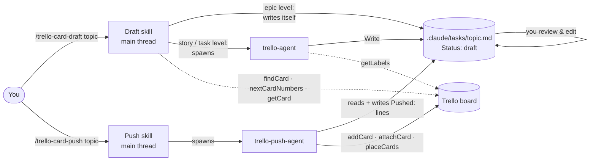
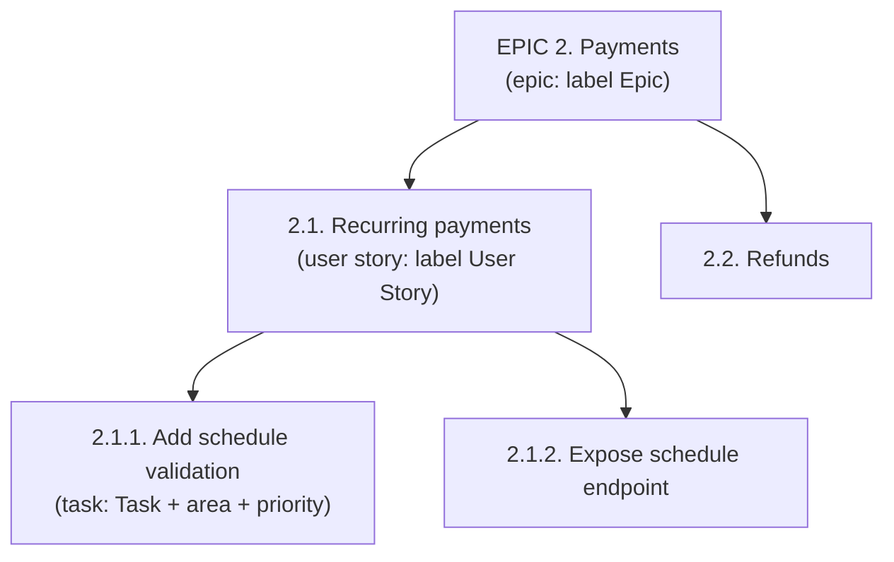
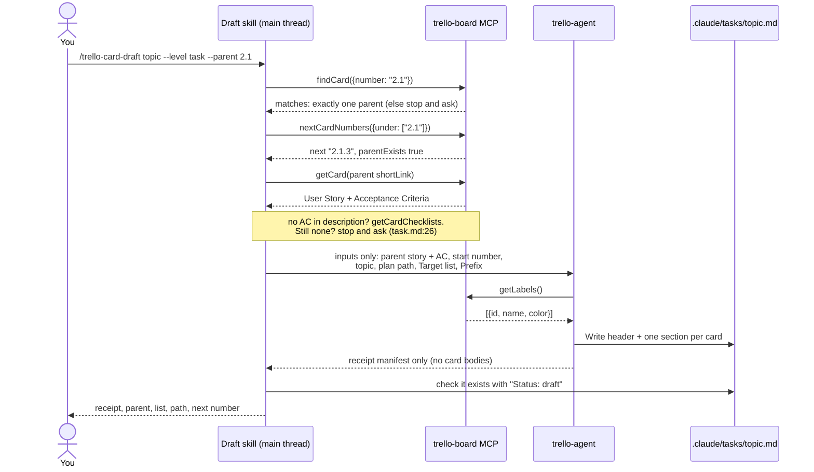
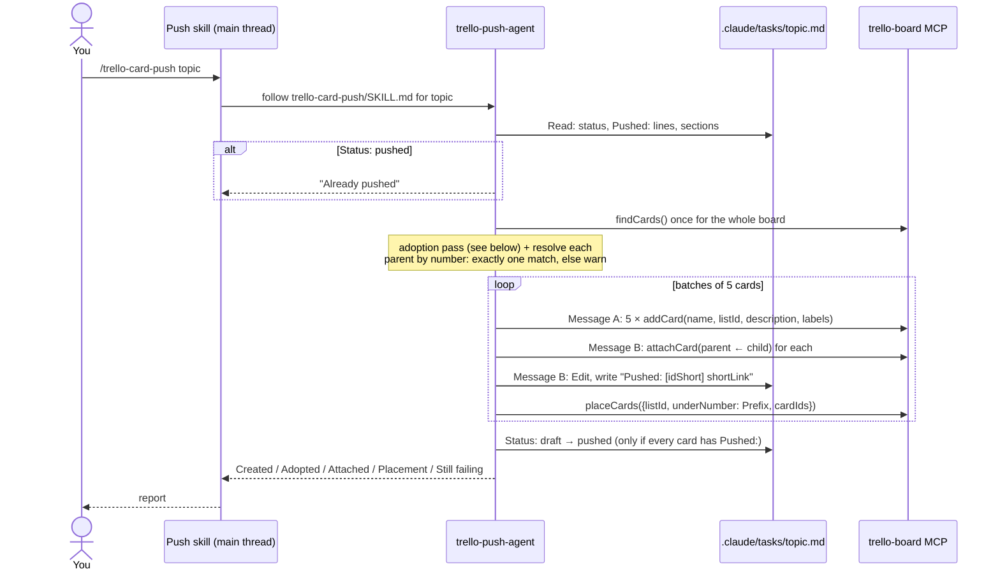
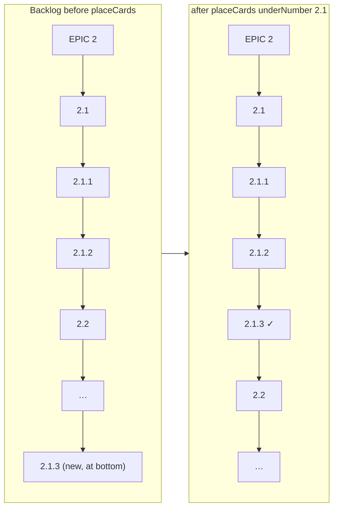
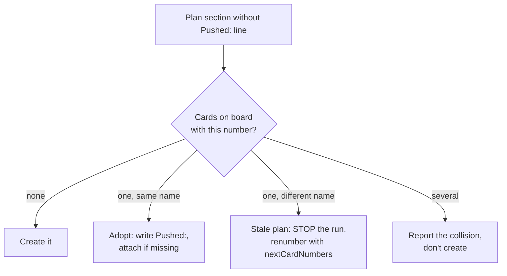
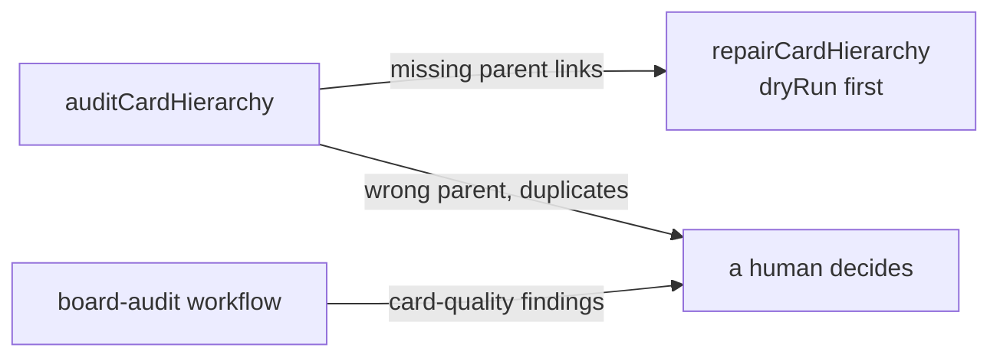

# How the card workflow works

A guide for developers to how this repo's skills, agents and MCP tools turn
an idea into numbered, linked Trello cards. Every diagram is based on the
files it names; the line references are there so you can check them.

**Files involved**

| Piece | File | Role |
|---|---|---|
| Draft skill | `.claude/skills/trello-card-draft/SKILL.md` (+ `references/epic.md`, `user-story.md`, `task.md`) | `/trello-card-draft`: resolves parent and numbers, delegates the writing |
| Writer agent | `.claude/agents/trello-agent.md` | Writes the card text into a plan file. **Cannot create cards.** |
| Push skill | `.claude/skills/trello-card-push/SKILL.md` | `/trello-card-push`: the push procedure, step by step |
| Push agent | `.claude/agents/trello-push-agent.md` | Follows the push skill and creates, attaches and places the cards |
| MCP server | `server/src/` | The Trello tools both agents call (`mcp__trello-board__*`) |
| Plan file | `.claude/tasks/<topic>.md` | The hand-off between draft and push, edited by you in between |

---

## 1. The big picture



Two phases with **you in the middle**. Drafting writes a plan file, never a
card. Only the push creates cards. Nothing reaches Trello until you've read
the plan, which is also why this flow isn't a Claude Code workflow: a
workflow can't stop halfway for you.

---

## 2. Numbering: the hierarchy lives in the card name



- **Parent = the number minus its last segment.** `2.1.2` → `2.1` → `2`
  (`trello-card-push/SKILL.md:47`, `server/src/utils/numbering.mjs`
  `parentNumber`).
- **New numbers always come from the `nextCardNumbers` tool, "never by
  eye".** It returns `max + 1` and compares numerically, so `2.1.10` comes
  after `2.1.9` (`references/task.md:20`, `references/epic.md:9`).
- **Archived numbers stay retired.** `nextCardNumbers` also reads archived
  cards (`filter: "all"`), so the number of an archived `2.1.2` is never
  handed out again (`numbering.mjs`, `hierarchy.mjs` `nextCardNumbers`).
- In Trello, each child is **attached to its parent** as a card link. The
  name says where a card belongs; the attachment makes it clickable. The
  `auditCardHierarchy` tool checks that the two agree.

---

## 3. Phase 1: drafting

`/trello-card-draft <topic> [--level epic|story|task] [--parent <number>] [--design <file>] [--docs <file>]`
(`trello-card-draft/SKILL.md:17`). The default level is `story`. Each run
works at exactly one level. `--parent` is the epic number at story level
(`--parent 2` → `2.1`, `2.2`, …) or the story number at task level
(`--parent 2.1` → `2.1.1`, …). If it's missing, the skill asks you instead of
guessing.

### Task level (the full path)



### What each level does differently

| | Epic | User story | Task |
|---|---|---|---|
| Who writes the cards | Main thread itself (`epic.md:11`) | `trello-agent` | `trello-agent` |
| Parent (`--parent`) | none | an epic: `findCard("2")` | a story: `findCard("2.1")` |
| Number source | `nextCardNumbers` → `nextEpic` | `nextUnder[prefix].next` | `nextUnder[prefix].next` |
| Reads the parent's AC | no | no | yes: `getCard`, falling back to `getCardChecklists` |
| Labels | `Epic` | `User Story` | `Task` + area + priority |
| Card body | 2–4 sentence description | As a / I want / so that + Given/When/Then | ≤ 2 sentence description + Given/When/Then |

**Why the agent only gets inputs.** The card format rules live in one place,
`trello-agent.md`, and the skill passes only run-specific values
(`task.md:58`). Two copies of the rules had already drifted apart once.

**Why only a receipt comes back.** The agent writes the cards straight to the
file and returns one line per card. The card text never enters the main
conversation, which keeps it small (`user-story.md:56`).

### The plan file

```markdown
# Task Plan: Recurring payments
Target list: Backlog
Prefix: 2.1
Status: draft

---

## 2.1.3. Add RecurringSchedule interval validation
Labels: Task, Backend, High Priority
Label IDs: <Task id>, <Backend id>, <High Priority id>
Description: Validate the interval field on the schedule schema in models/schedule.py.
**Acceptance Criteria:**
- **Given** a schedule with interval 0. **When** it is saved. **Then** a 422 names the field.
```

Format from `trello-agent.md:70-103`. Tasks are numbered in **execution
order**: setup first, then endpoints, then UI, then end-to-end wiring
(`trello-agent.md:36-38`). This is the moment to **review and edit**: rename
cards, drop some, change labels.

---

## 4. Phase 2: pushing

`/trello-card-push <topic>`. The main thread only starts the push agent and
passes its report back to you. It never reads the plan itself, so the card
text doesn't pass through the conversation twice (`trello-card-push/SKILL.md:19-23`).



### Placement: where new cards land in the list

Trello puts a new card at the bottom of the list. `placeCards` moves the
batch to just after the **last card of the parent's subtree**, so the
backlog keeps reading epic → story → its tasks
(`trello-card-push/SKILL.md:120-132`):



Epic plans skip `placeCards`: a new epic belongs at the end anyway, after a
`---` separator card (`SKILL.md:136-138`).

### Safe to re-run: the adoption pass

A push can crash halfway, for example after `addCard` but before the
`Pushed:` line is written. Re-running it never creates a card twice. Each
unpushed section is first looked up on the board by its number
(`SKILL.md:58-62`):



The `Pushed: [idShort] shortLink` lines are what the push trusts. Sections
that have one are never sent to `addCard` again (`SKILL.md:31`, `:166`).

### When something fails

| What failed | What happens (`SKILL.md:151-166`) |
|---|---|
| Unknown label | Card is created without that label, with a warning |
| Parent not found, or several | Card is created without a parent link; reported |
| `addCard` | No `Pushed:` line; status stays `draft`; re-run retries it |
| `attachCard` | Card kept, `Pushed:` still written; fix with `repairCardHierarchy` |
| `placeCards` | Nothing re-created; reported; re-run is safe |

---

## 5. Who can call what

Each agent's `tools:` line is a hard permission boundary, and it's
deliberate:

| Agent | MCP tools | Can't, by design |
|---|---|---|
| `trello-agent` (writer) | `getLabels` only (`trello-agent.md:4`) | Create or change any card. A draft can never touch the board. |
| `trello-push-agent` | `getLists`, `getCardsByList`, `findCards`, `listCardAttachments`, `addCard`, `attachCard`, `placeCards` (`trello-push-agent.md:4`) | `moveCard`, `updateCard`, `archiveCard`, `repairCardHierarchy`. When it hits a stop condition, all it can do is report. |
| `board-audit` workflow agents | Read tools only, enforced in the prompt | Write anything |

---

## 6. Where the ids come from

| Id | Source | Fallback |
|---|---|---|
| Label ids | `getLabels`, called live by the drafter (`trello-agent.md:63`) | `server/trello-board-ids.md` label table, only if the call fails |
| List id for `Target list` | `getLists`, called live by the push agent and matched by name | The `server/trello-board-ids.md` List ID map, only if the call fails. No match → the push stops before creating anything |
| Board | `TRELLO_BOARD_ID`. The push calls `findCards` with no board (`trello-card-push/SKILL.md:54`) | None |

### Before your first push

1. Set **`TRELLO_BOARD_ID`**. It's optional for the MCP server but
   **required for this workflow**.
2. Make sure the plan's **`Target list`** exists on the board. Drafts
   default to `Backlog`. If your board has no such list, edit the plan's
   `Target list:` line before pushing; otherwise the push stops and lists
   the lists that do exist.
3. Make sure the board has the labels the drafter uses: `Epic`,
   `User Story`, `Task`, `Frontend`, `Backend`, `DevOps`, `Ai Feature`, and
   `High`/`Medium`/`Low Priority`. A missing label is skipped with a warning,
   not created.

---

## 7. Checking the result



- `auditCardHierarchy` compares the parent links on the board with what the
  numbers imply. It's read-only.
- `repairCardHierarchy` only fills in **missing** links (use
  `dryRun: true` first). Anything ambiguous is left for a person.
- The `board-audit` workflow checks labels and acceptance criteria against
  the conventions above. See the README.
